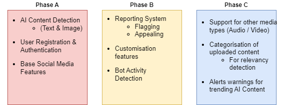

# School of Computing &mdash; Year 4 Project Proposal Form

## SECTION A

|                     |                   |
|---------------------|-------------------|
|Project Title:       | VeriSocial            |
|Student 1 Name:      | Javier Alejandro Flores Baez           |
|Student 1 ID:        | 21748521            |
|Student 2 Name:      | Joaquin Escober            |
|Student 2 ID:        | 21746259            |
|Project Supervisor:  | Dr Graham Healy            |

## SECTION B

### Introduction

Nowadays, the social media landscape has given rise to AI generated content and automated bot activity, significantly reducing the quality of the online experience. Many users encounter fake profiles, manipulative media and inauthentic conversations, which not only betrays trust but dilutes the original purpose that social media platforms were intended for. As a result, it becomes increasingly difficult to distinguish between real users and content from artificially generated ones.

### Outline
VeriSocial is a unique social platform designed to prioritise authentic human interaction. With the rise of artificial content and automated bot interactions, the online experience becomes plagued for the everyday user, which dilutes their overall experience. VeriSocial addresses this issue by providing a space for users and implementing a system that detects and filters out AI generated content or bot activity. This allows users to confidently browse and connect with others knowing that every piece of media or interaction is authentic and human.

**Phase A** 
For the first part of our project - we will focus on creating a platform that will allow us to implement our anti AI system. This includes creating a base Social Media Platform, complete with the standard features you see in many modern social media applications. Features include:

- **Account Registration and Login**: Users will be able to create accounts and be able to log in
- **User Authentication**: to prevent automated account generated, users are required to authenticate their registration process before being given an account
- **Posting Content**: Users will be able to upload their content. Initially this will include Text and Images only. (Other formats such as audio or video may be added later)
- **Comments**: Users will be able to comment on posts.
- **Feed**: Users will be able to see posts on the homepage made by other users.

 **Phase B** 
For this section of the project - the focus will shift on the implementation of our Anti AI / Bot system. This will allow our platform to detect AI generated content on any uploaded post / comment made by users. Planned features include:

- **AI Content Detection**: Any uploaded content, post or comments, will be put through a “detection” process to check if said content is AI generated or not.
- **Bot / Autonomous Activity Detection**: The platform will detect unusual bot activity. E.g Spamming and Bot Advertising
- **Flagging and Appealing System**: A way for users to report bypassed AI content or Users on the platform. As well as a system for users to appeal posts that have been mistaken as AI.
- **Monitoring**: All posts and interactions need to be monitored, as we believe the AI will most likely not be the most reliable that we would have found and thus we need to be able to see how many people are complaining about the AI’s decision.

 **Phase C** 
Phase A and B consist of the main base planned features. Phase C will consist of other features that won’t be core to the project - but will provide additional features that aim to enrich it.

- **Support for other Media types**:  So far only Text and Images will be planned. Audio or Video can also be added.
- **Categorisation**: Any uploaded content will be automatically categorised. This will allow us to implement relevancy checks against Posts and its comments. (Aim to get rid of automated comments, which promote or advertise content not related to the original post).
- **Alerts and Trends**: VeriSocial will display Trending content and also warn users about surges of Bot Activity in specific categories.
- **User Profile Customisation**: Users will be able to customise their accounts / profiles. This can include, Profile Images, Description, Account statistics, etc.

  
   <i>Initial planned phases</i>

### Background
Our experience with the online landscape has drastically changed over the last few years with the increasing rise of AI. We have witnessed firsthand how the evolution of AI has impacted onlines spaces, particularly in areas such as content creation and account automation. Some examples of the issues we have experienced:

- **AI-Generated Art and Media**: 
Platforms like Instagram and X (formerly Twitter), have seen a surge in AI generated art. Many of which have become indistinguishable from human-made art. This serves as a great challenge for actual artists who struggle to make a living and stand out in the market. Some users also go as far as to promote their AI-generated art, stating it to be human-made, which raises concerns about authenticity and trust for online media. At the same time, AI generated media allows for a quicker spread of misinformation, which can be very harmful to users.

- **Automated Spam Bots and Fake Accounts**: 
Many platforms are also vulnerable to Bot accounts and activity. These bots disguise themselves as real users and can be often found posting content or within comment sections to promote their products or increase engagement for a specific person / group. More serious examples often include bots promoting scams to unsuspecting users. Many of these automated bots flood comment sections, which again dilutes the quality of the online landscape.

After experiencing first hand these issues, we realised how frustrating and misleading these problems can be. We wanted to create a space where authenticity is prioritised. Hence the creation of VeriSocial.

### Achievements
The idea behind the project is to try to mitigate the rise of AI-generated content in social media. We aim to create a service that people can use to both “verify” posts, and thus our users can enjoy authentic content with a certain degree of guarantee that what they are seeing was made by a person.

**Features / Functions** 
At the core of VeriSocial, we are building an online social platform where users can post, comment, and engage with each other. Behind the scenes, content that is uploaded to our platform will filter out AI-generated content and bot-like behaviour. Key features include:

- **Web Application Interface**: Users will interact with VeriSocial through an intuitive, user-friendly web interface, enabling seamless browsing and engagement.
- **Account Registration & Login**: Users can create accounts, log in securely, and authenticate their identity to prevent the creation of automated or fake accounts.
- **Posting & Commenting**: Users can post text and images, and comment on others' posts. All content is automatically checked for AI generation or suspicious bot activity.
- **AI Content Detection**: Every piece of uploaded content is put through a verification process to detect whether it is AI-generated, ensuring an authentic social experience.
- **Bot Activity Monitoring**: The platform constantly monitors for unusual activity patterns (e.g., spamming or automated interactions) to identify and prevent bot-like behaviour.
- **Flagging & Appeals**: Users can report flagged content or appeal if their posts are incorrectly labelled as AI-generated.

The project must also achieve a stable status as a social media. This means creating a system that can be monitored, be reliable and secure. 

Observability must be a priority for our project, as this is how we will be able to monitor how well people are reacting to our different detection methods inside our product. 

### Justification

The idea for VeriSocial stems from the growing concern around the rise of AI generated content and bot activity online. Overtime AI has advanced to a point where it becomes increasingly difficult for users to distinguish between authentic human interaction and automated or artificially generated posts. This overall dilutes the online experience for users as browsing becomes more crowded with non-human activity. For our app VeriSocial, we aim to create a space that filters out AI content, allowing users to engage with others confidently knowing that they are interacting with real people.

**Who will use it?** 
For users who value authentic human interaction and content, VeriSocial will provide the platform free from AI content and Bots. This is especially important to those in particular who are vulnerable to bot scam comments and those easily susceptible to fake content. This includes people of all age ranges, young or old. 

### Programming language(s)

> - Rust/Python for backend
> - Python (Hugging Face)
> - SQL
> - Javascript (React)
> - HTML & CSS

 **Specific Models we plan on using for the AI Detection (Hugging Face)** 
Images: [/NYUAD-ComNets/AI-generated_images_detector](https://huggingface.co/NYUAD-ComNets/AI-generated_images_detector)

Text: [/akshayvkt/detect-ai-text](https://huggingface.co/akshayvkt/detect-ai-text)

### Programming tools / Tech stack

> - Gitlab CI/CD
> - Observability Stack (ELK)
> - Docker Compose
> - PostgreSQL/ MySQL/ MongoDB
> - Postman
> - Xyz top level domain

### Hardware

> - AWS (Amazon Web Services) 

### Learning Challenges
The following are some challenges that we will be tackling.

**Operational use of AI Models and Performance**: Optimising performance is crucial in delivering a user-friendly experience. AI models can be computationally expensive so learning to optimise the environment of execution for our models will add more challenges to our project. Not only this, but we must be able to integrate these models into our system seamlessly. The handling of different media types is also something to consider. (Currently Image and Text are planned, but Video and Audio media may be added into the project too).

**False Positives and User Appeals**: 
With a system such as an anti AI filter, false positives will definitely pose a challenge for us. In testing we may encounter false positives so creating a system to handle that becomes crucial so that end-users may be able to correct the system’s errors. We would need to develop workflows and tools to efficiently manage these appeals. This would need to be a fair and transparent process to ensure user trust.

### Breakdown of work

The project will be mainly divided into 2 parts. The Back-end side and Front-end side (alongside testing and documention). Below are a list of the planned tasks for each student:

#### **Student 1** - Javier Alejandro Flores Baez

> - B/E Development
>   - Base API operations for user operations
>   - Authentication
> - Infrastructure Development
>   - Observability stack
> - Deployment

#### **Student 2** - Joaquin Escober

> - F/E Development
>   - Social Media Webpage
>   - User Login and Registration
>   - User Feed and Profiles
>   - User Posting and Commenting
>   - Customisation
> - Designing the interface
> - Testing and Documentation

> **Both Students will be responsible in implementing and integrating the AI Models.**

> **Both students will review each other's code.**
